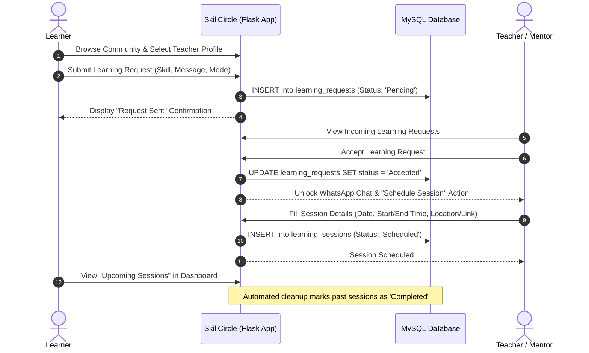

# SkillCircle — Peer-to-Peer Community Skill Sharing Platform

[](https://www.python.org/)
[](https://flask.palletsprojects.com/)
[](https://www.mysql.com/)
[](#system-architecture)
[](#license)

> **"Everyone knows something. Everyone can learn."**  
> SkillCircle is a hyper-local, community-driven skill exchange platform that connects learners and mentors within neighborhoods, campuses, and cities to trade skills, schedule collaborative learning sessions, and foster mutual growth without commercial barriers.

---

## Table of Contents

1. [Problem Statement](#problem-statement)
2. [The SkillCircle Solution](#the-skillcircle-solution)
3. [Key Features](#key-features)
4. [System Architecture & Workflow](#system-architecture--workflow)
5. [Technology Stack](#technology-stack)
6. [Database Schema (DDL)](#database-schema-ddl)
7. [Project Directory Structure](#project-directory-structure)
8. [Installation & Setup Guide](#installation--setup-guide)
9. [Environment Variables Configuration](#environment-variables-configuration)
10. [Application Modules & Working Flow](#application-modules--working-flow)
11. [External Integrations](#external-integrations)
12. [Security & Privacy Features](#security--privacy-features)
13. [Future Roadmap](#future-roadmap)
14. [Contributing & License](#contributing--license)

---

## Problem Statement

In today's fast-paced digital and academic ecosystem, continuous learning is essential. However, individuals face critical barriers:

* **High Cost of Education & Tutoring:** Commercial platforms, bootcamps, and professional tutoring services charge high fees, creating economic hurdles for students and hobbyists.
* **Rigid One-Way Roles:** Traditional platforms divide users strictly into "paid tutors" and "paying students." In reality, someone who needs help with Web Development might be an exceptional guitarist, language speaker, or mathematician.
* **Lack of Hyper-Local Community Connection:** Neighbors, college peers, and local residents often possess rich talents and expertise, but have no structured, trusted channel to discover one another.
* **Scheduling and Accountability Friction:** Informal learning via social media groups often falls apart due to lack of scheduling tools, follow-ups, and session tracking.
* **Privacy & Trust Concerns:** Sharing personal phone numbers or contact details with strangers upfront exposes users to spam, harassment, and privacy violations.

---

## The SkillCircle Solution

**SkillCircle** flips the traditional dynamic on its head by implementing a reciprocal **Peer-to-Peer (P2P) Knowledge Exchange**:

* **Dual-Role Profiles:** Every member can list skills they can **teach** alongside skills they wish to **learn**, complete with proficiency levels (Beginner, Intermediate, Advanced).
* **Location-Aware Discovery:** Users can explore skills across the entire community or filter by their local city/area using automated **Indian Postal PIN Code** resolution.
* **Protected Request Lifecycle:** Direct contact (such as WhatsApp chat) is only unlocked once both parties mutually accept a formal learning request.
* **Dedicated Session Scheduling & Auto-Tracking:** Seamlessly organize, schedule, and log online or in-person sessions with meeting links, physical locations, and automated session-status tracking.
* **Zero Paywall Philosophy:** Knowledge is shared peer-to-peer, empowering communities to thrive on collaborative goodwill and mutual growth.

---

## Key Features

### 1. Authentication & Security
* **Email Verification via OTP:** Registration requires 6-digit email OTP verification via SMTP before activating the account.
* **Secure Credential Handling:** Passwords and temporary OTPs are hashed using cryptographic salt (`werkzeug.security.generate_password_hash`).
* **Self-Service Password Reset:** Time-limited (10-minute) OTP verification with attempt throttling to prevent brute-force attacks.
* **Session Protection:** Secure session cookies and authentication checks guarding all sensitive dashboard and user routes.

### 2. User Profiles & Dual Skill Inventory
* **Detailed Biographies:** Bio, primary city, neighborhood locality, 6-digit PIN code, preferred mode (Online / Offline / Both), and general availability.
* **Auto Locality Lookup:** Instant automatic resolution of Indian PIN codes to post offices/localities and districts.
* **Teaching Portfolio:** Add custom skills with category tags, descriptions, and experience levels.
* **Learning Goals:** Pinpoint topics you want to master to get matched with suitable peers.

### 3. Community Directory & Discovery Engine
* **Multifaceted Filters:** Filter by skill category (Technology, Languages, Creative, Academic, Everyday Life, Career), learning mode, and availability.
* **Location Scope:** Switch between "My Community" (users within your own city/region) and "All Users".
* **Public Profiles:** View badges, teaching capabilities, learning interests, and community engagement before initiating contact.

### 4. Connection Requests & Collaborative Sessions
* **Structured Requests:** Send learning requests with custom introductory messages and proposed learning modes.
* **Request Management:** Accept, reject, or cancel incoming/outgoing requests with status badges (`Pending`, `Accepted`, `Rejected`, `Cancelled`).
* **Direct Communication Gate:** WhatsApp direct-link integration (`wa.me`) is activated only for accepted matches.
* **Session Scheduler:** Plan specific dates, start times, end times, modes, and venue/meeting URLs.
* **Automated Session Completion:** Background cron/routine updates expired scheduled sessions to `Completed`.

### 5. Policies & Community Safety
* Dedicated safety and compliance pages:
  * Community Guidelines & Safety Tips for in-person and online meetups.
  * Terms of Service, Privacy Policy, Cookie Policy, and Accessibility commitment.

---

## System Architecture & Workflow

### Architectural Overview

```
 ┌────────────────────────────────────────────────────────┐
 │                      Client Browser                    │
 │         (HTML5 / CSS3 / Vanilla JavaScript / Jinja2)   │
 └───────────────────────────┬────────────────────────────┘
                             │ HTTP / HTTPS (RESTful Routes)
                             ▼
 ┌────────────────────────────────────────────────────────┐
 │                     Flask Application                  │
 │                        (app.py)                        │
 ├───────────────────────────┬────────────────────────────┤
 │ • Route Controllers       │ • Authentication & Hashing │
 │ • Input Validation & San. │ • Auto Session Lifecycle   │
 │ • Pin Code Cache Engine   │ • Session Management       │
 └─────────────┬───────────────────────────┬──────────────┘
               │                           │
      PyMySQL  ▼                           ▼  smtplib / HTTPS
 ┌───────────────────────────┐   ┌─────────────────────────────┐
 │       MySQL Database      │   │     External Services       │
 │   • users                 │   │ • SMTP Mail Server (Gmail)  │
 │   • user_profiles         │   │ • postalpincode.in API      │
 │   • skills                │   │ • WhatsApp Click-to-Chat    │
 │   • user_teaching_skills  │   └─────────────────────────────┘
 │   • user_learning_skills  │
 │   • learning_requests     │
 │   • learning_sessions     │
 └───────────────────────────┘
```

### Peer Learning Request & Session Sequence



---

## Technology Stack

| Layer | Technology | Purpose |
|---|---|---|
| **Backend Framework** | [Flask 3.1.2](https://flask.palletsprojects.com/) | Micro-framework handling HTTP routing, sessions, templates, and REST endpoints |
| **Language** | [Python 3.10+](https://www.python.org/) | Core backend programming language |
| **Database** | [MySQL](https://www.mysql.com/) / [MariaDB](https://mariadb.org/) | Relational database for persistent storage |
| **Database Driver** | [PyMySQL 1.2.3](https://github.com/PyMySQL/PyMySQL) | Pure-Python MySQL client library using dictionary cursors |
| **Frontend Templates** | [Jinja2](https://jinja.palletsprojects.com/) | Server-side templating engine for modular layouts and components |
| **Styling** | Vanilla CSS3 | Custom design system, responsive flexbox/grid, theme tokens, and animations |
| **Interactivity** | Vanilla JavaScript (ES6+) | Postal PIN code auto-fill, dynamic modals, and interactive UI states |
| **Mailing Service** | `smtplib` + `email.message` | Sending transactional verification and password-reset OTP emails |
| **Environment Config** | [python-dotenv 1.2.2](https://github.com/theskumar/python-dotenv) | Secure 12-factor configuration loading via `.env` |
| **Third-Party APIs** | [Postal PIN Code API](https://api.postalpincode.in/) | Real-time Indian PIN code resolution to locality and district |

---

## Database Schema (DDL)

Run the following SQL commands in your MySQL console or phpMyAdmin to initialize the complete database:

```sql
CREATE DATABASE IF NOT EXISTS skillcircle 
CHARACTER SET utf8mb4 
COLLATE utf8mb4_unicode_ci;

USE skillcircle;

-- 1. Users table
CREATE TABLE IF NOT EXISTS users (
    id INT AUTO_INCREMENT PRIMARY KEY,
    full_name VARCHAR(100) NOT NULL,
    email VARCHAR(150) NOT NULL UNIQUE,
    password_hash VARCHAR(255) NOT NULL,
    is_verified TINYINT(1) DEFAULT 0,
    verification_code_hash VARCHAR(255) DEFAULT NULL,
    verification_code_expires_at DATETIME DEFAULT NULL,
    verification_attempts INT DEFAULT 0,
    reset_code_hash VARCHAR(255) DEFAULT NULL,
    reset_code_expires_at DATETIME DEFAULT NULL,
    reset_attempts INT DEFAULT 0,
    created_at TIMESTAMP DEFAULT CURRENT_TIMESTAMP
);

-- 2. User Profiles table
CREATE TABLE IF NOT EXISTS user_profiles (
    id INT AUTO_INCREMENT PRIMARY KEY,
    user_id INT NOT NULL UNIQUE,
    bio TEXT,
    location_area VARCHAR(150),
    city VARCHAR(100),
    pincode VARCHAR(6),
    learning_mode ENUM('Online', 'Offline', 'Both') DEFAULT 'Both',
    availability VARCHAR(150),
    whatsapp_number VARCHAR(20),
    created_at TIMESTAMP DEFAULT CURRENT_TIMESTAMP,
    updated_at TIMESTAMP DEFAULT CURRENT_TIMESTAMP ON UPDATE CURRENT_TIMESTAMP,
    FOREIGN KEY (user_id) REFERENCES users(id) ON DELETE CASCADE
);

-- 3. Skills Catalog
CREATE TABLE IF NOT EXISTS skills (
    id INT AUTO_INCREMENT PRIMARY KEY,
    skill_name VARCHAR(100) NOT NULL UNIQUE,
    category VARCHAR(50) NOT NULL,
    description TEXT,
    created_at TIMESTAMP DEFAULT CURRENT_TIMESTAMP
);

-- 4. User Teaching Skills (Skills user can teach)
CREATE TABLE IF NOT EXISTS user_teaching_skills (
    id INT AUTO_INCREMENT PRIMARY KEY,
    user_id INT NOT NULL,
    skill_id INT NOT NULL,
    skill_level ENUM('Beginner', 'Intermediate', 'Advanced', 'Expert') DEFAULT 'Intermediate',
    created_at TIMESTAMP DEFAULT CURRENT_TIMESTAMP,
    UNIQUE KEY unique_user_teaching_skill (user_id, skill_id),
    FOREIGN KEY (user_id) REFERENCES users(id) ON DELETE CASCADE,
    FOREIGN KEY (skill_id) REFERENCES skills(id) ON DELETE CASCADE
);

-- 5. User Learning Skills (Skills user wants to learn)
CREATE TABLE IF NOT EXISTS user_learning_skills (
    id INT AUTO_INCREMENT PRIMARY KEY,
    user_id INT NOT NULL,
    skill_id INT NOT NULL,
    skill_level ENUM('Beginner', 'Intermediate', 'Advanced', 'All') DEFAULT 'Beginner',
    created_at TIMESTAMP DEFAULT CURRENT_TIMESTAMP,
    UNIQUE KEY unique_user_learning_skill (user_id, skill_id),
    FOREIGN KEY (user_id) REFERENCES users(id) ON DELETE CASCADE,
    FOREIGN KEY (skill_id) REFERENCES skills(id) ON DELETE CASCADE
);

-- 6. Learning Requests
CREATE TABLE IF NOT EXISTS learning_requests (
    id INT AUTO_INCREMENT PRIMARY KEY,
    learner_id INT NOT NULL,
    teacher_id INT NOT NULL,
    skill_id INT NOT NULL,
    message TEXT,
    preferred_mode ENUM('Online', 'Offline', 'Both') DEFAULT 'Both',
    status ENUM('Pending', 'Accepted', 'Rejected', 'Cancelled') DEFAULT 'Pending',
    created_at TIMESTAMP DEFAULT CURRENT_TIMESTAMP,
    updated_at TIMESTAMP DEFAULT CURRENT_TIMESTAMP ON UPDATE CURRENT_TIMESTAMP,
    FOREIGN KEY (learner_id) REFERENCES users(id) ON DELETE CASCADE,
    FOREIGN KEY (teacher_id) REFERENCES users(id) ON DELETE CASCADE,
    FOREIGN KEY (skill_id) REFERENCES skills(id) ON DELETE CASCADE
);

-- 7. Learning Sessions
CREATE TABLE IF NOT EXISTS learning_sessions (
    id INT AUTO_INCREMENT PRIMARY KEY,
    request_id INT NOT NULL,
    teacher_id INT NOT NULL,
    learner_id INT NOT NULL,
    skill_id INT NOT NULL,
    session_date DATE NOT NULL,
    start_time TIME NOT NULL,
    end_time TIME NOT NULL,
    learning_mode VARCHAR(50) NOT NULL,
    meeting_details TEXT,
    status ENUM('Scheduled', 'Completed', 'Cancelled') DEFAULT 'Scheduled',
    created_at TIMESTAMP DEFAULT CURRENT_TIMESTAMP,
    FOREIGN KEY (request_id) REFERENCES learning_requests(id) ON DELETE CASCADE,
    FOREIGN KEY (teacher_id) REFERENCES users(id) ON DELETE CASCADE,
    FOREIGN KEY (learner_id) REFERENCES users(id) ON DELETE CASCADE,
    FOREIGN KEY (skill_id) REFERENCES skills(id) ON DELETE CASCADE
);
```

---

## Project Directory Structure

```plaintext
pbl/
├── .env                          # Local environment variables & secrets (keep private)
├── .gitignore                    # Git ignore file for Python, cache & environment
├── app.py                        # Main Flask application (routes, business logic)
├── db.py                         # PyMySQL database connection helper
├── mail.py                       # SMTP email delivery helper (OTP verification)
├── requirements1.txt             # Python package dependencies
│
├── static/                       # Static web assets
│   ├── style.css                 # Global styling, color tokens, typography
│   └── user/                     # Modular styles for user pages
│       ├── community.css         # Community discovery & filter grid
│       ├── dashboard.css         # User dashboard & overview
│       ├── learning_requests.css # Requests management layout
│       ├── learning_sessions.css # Scheduled sessions & timeline
│       ├── login.css             # Authentication layouts
│       ├── profile.css           # Profile editor & skill management
│       └── public_profile.css    # Public peer profile view
│
└── templates/                    # Jinja2 HTML templates
    ├── index.html                # Public landing page
    ├── Policies & safety/        # Safety & legal documents
    │   ├── accessibility.html    # Accessibility commitment
    │   ├── community_guidelines.html # Rules of conduct
    │   ├── cookie_policy.html    # Cookie usage info
    │   ├── privacy.html          # Privacy policy
    │   ├── safety_tips.html      # Online/offline meetup tips
    │   └── terms.html            # Terms of service
    └── user/                     # Authenticated user views
        ├── navbar.html           # Unified navigation bar component
        ├── register.html         # Registration form
        ├── verify_email.html     # 6-digit email OTP verification
        ├── login.html            # Login page
        ├── forgot_password.html  # Password recovery request
        ├── reset_password.html   # Password reset OTP verification
        ├── new_password.html     # Set new password
        ├── dashboard.html        # Main dashboard
        ├── profile.html          # Profile settings & skill portfolio
        ├── public_profile.html   # Public member profile card
        ├── community.html        # Community discovery & directory
        ├── request_to_learn.html # Send learning request modal/form
        ├── learning_requests.html# Incoming & outgoing request center
        ├── schedule_session.html # Schedule session form
        └── learning_sessions.html# Active & historical sessions
```

---

## Installation & Setup Guide

### 1. Prerequisites
Ensure you have the following installed on your operating system:
* **Python**: Version 3.10 or higher (`python3 --version`)
* **MySQL Server**: MySQL 8.0+ or MariaDB 10.4+ (e.g., via Homebrew, MySQL Community Server, or XAMPP)
* **Git**: To clone and version-control the repository

### 2. Clone the Repository
```bash
git clone https://github.com/adityaph-17/SKILLCIRCLE.git
cd SKILLCIRCLE
```

### 3. Create and Activate a Virtual Environment
```bash
# macOS / Linux:
python3 -m venv environment
source environment/bin/activate

# Windows (Command Prompt):
python -m venv environment
environment\Scripts\activate.bat

# Windows (PowerShell):
python -m venv environment
environment\Scripts\Activate.ps1
```

### 4. Install Dependencies
```bash
pip install -r requirements1.txt
```

### 5. Setup the MySQL Database
1. Open your MySQL CLI or GUI client (phpMyAdmin, MySQL Workbench, DBeaver):
   ```bash
   mysql -u root -p
   ```
2. Execute the SQL commands provided in the [Database Schema (DDL)](#database-schema-ddl) section.

### 6. Configure Environment Variables
Create a file named `.env` in the root project directory (or copy from the template below) and supply your database credentials and Gmail App Password:
```bash
touch .env
```

Fill in the details according to the [Environment Variables Configuration](#environment-variables-configuration) section.

### 7. Run the Application
```bash
python app.py
```
By default, the server will start in debug mode on:
```
http://127.0.0.1:5000/
```

Open this URL in your web browser to explore SkillCircle.

---

## Environment Variables Configuration

Create a `.env` file in the project root with the following keys:

```ini
# Flask Secret Key (used for signing session cookies)
FLASK_SECRET_KEY=your-super-secret-random-key-here

# MySQL Database Configuration
DB_HOST=localhost
DB_USER=root
DB_PASSWORD=your_mysql_password
DB_NAME=skillcircle

# Mail Configuration (Gmail SMTP)
MAIL_SERVER=smtp.gmail.com
MAIL_PORT=587
MAIL_USERNAME=your_email@gmail.com
MAIL_PASSWORD=your_16_character_google_app_password
MAIL_USE_TLS=True
```

> [!TIP]
> **Gmail App Password Setup:**  
> If using Gmail, make sure 2-Factor Authentication is enabled on your Google Account, then generate an **App Password** under `Security > 2-Step Verification > App passwords`. Use this 16-character generated password for `MAIL_PASSWORD`.

---

## Application Modules & Working Flow

### 1. User Onboarding Flow
1. **Sign Up:** A new user navigates to `/register`, enters their name, email, and password, and agrees to the terms.
2. **OTP Dispatch:** The app creates a provisional record, generates a cryptographically secure 6-digit OTP, stores its hash with a 10-minute expiry, and emails it to the user.
3. **Verification:** The user inputs the OTP at `/verify-email`. Once verified, `is_verified` is set to `1`, and the user is logged into their personalized dashboard.

### 2. Profile & Skills Management
1. Users visit `/profile` to add a bio, contact information (WhatsApp number), and their 6-digit postal PIN code.
2. Typing a PIN code triggers an asynchronous fetch to `/api/pincode/<pincode>`, auto-populating city, district, and available localities.
3. Users browse existing skills or create new ones, then assign them to:
   * **Skills I Can Teach** (along with proficiency level).
   * **Skills I Want to Learn** (goals and target levels).

### 3. Finding Peers in the Community
1. Users navigate to `/community`.
2. The search engine allows filtering by:
   * **Location Scope:** "My Community" limits results to peers residing in the same city; "All Users" opens search globally.
   * **Keywords:** Search for specific names or skill titles.
   * **Category:** Technology, Creative, Languages, Academic, Career, Everyday Life.
   * **Mode:** Online or In-person.
3. Selecting a user opens `/user/<id>` showing their verified badges, teaching skills, and learning goals.

### 4. Requesting & Accepting Learning Connections
1. On a peer's public profile, clicking **"Request to Learn"** loads `/request-to-learn/<teacher_id>/<skill_id>`.
2. The learner specifies preferred mode (Online/Offline) and an introductory note.
3. The teacher reviews incoming requests on `/learning-requests`.
4. Once the teacher clicks **Accept**:
   * A direct **WhatsApp Connect** link becomes available for real-time discussion.
   * Both parties can initiate **Schedule Session**.

### 5. Scheduling and Tracking Sessions
1. The teacher visits `/schedule-session/<request_id>` to set the session date, start time, end time, mode, and meeting details (Google Meet/Zoom link or physical address).
2. The session appears under `/learning-sessions` under **Upcoming Sessions**.
3. Every time sessions are loaded, `auto_complete_past_sessions()` automatically checks for expired sessions and marks them as **Completed**.

---

## External Integrations

1. **Postal PIN Code Directory API (`api.postalpincode.in`):**
   * Dynamically resolves 6-digit Indian PIN codes to town, district, and state.
   * Includes server-side in-memory caching to avoid redundant calls and optimize latency.
2. **Google SMTP Gateway:**
   * Delivers transactional HTML/text emails over TLS on port 587.
3. **WhatsApp Click-to-Chat (`wa.me`):**
   * Encodes phone number and pre-formatted introductory text so peers can connect instantly on mobile or WhatsApp Web.

---

## Security & Privacy Features

* **Password & Secret Hashing:** Never stores plaintext passwords or OTPs; leverages PBKDF2 with SHA-256 via Werkzeug.
* **Brute-Force Throttling:** Limits consecutive OTP entry attempts during email verification and password resets.
* **Controlled Contact Disclosure:** Phone and WhatsApp contacts are hidden until both parties explicitly agree to a learning connection.
* **SQL Injection Prevention:** Uses parameterized SQL queries with `pymysql` parameter substitution across all database interactions.
* **XSS Safeguards:** Jinja2 server-side escaping is applied across all dynamic templates.
* **Strict Authentication Guards:** Protected routes enforce active session validation, redirecting unauthenticated users to `/login`.

---

## Future Roadmap

- [ ] **Direct In-App Real-Time Messaging:** WebSockets/Socket.IO chat within the platform.
- [ ] **Mutual Rating & Review System:** Star reviews and endorsements for verified completed sessions.
- [ ] **Calendar Synchronization:** Generate `.ics` files and Google Calendar 1-click invite links for scheduled sessions.
- [ ] **Badge & Karma System:** Reward active mentors with community contribution badges.
- [ ] **Group Circles & Workshops:** Enable teachers to host multi-student cohort workshops.

---

## Contributing & License

### Contributing
Contributions, suggestions, and pull requests are warmly welcomed!
1. Fork the Project repository.
2. Create your Feature Branch (`git checkout -b feature/AmazingFeature`).
3. Commit your changes (`git commit -m 'Add some AmazingFeature'`).
4. Push to the Branch (`git push origin feature/AmazingFeature`).
5. Open a Pull Request.

### License
Distributed under the **MIT License**. See `LICENSE` for more information.

---

<div align="center">
  <sub>SkillCircle — Built for Project Based Learning (PBL). Fostering collaborative peer learning, one skill at a time.</sub>
</div>
